# 🚗 FleetOps: Vehicle Maintenance Portal

A full-stack low-code solution on **Microsoft Power Platform** that digitizes and automates vehicle maintenance workflows, from request creation and line-item costing to **PDF invoice generation** and **smart approval routing** through Outlook and MS Teams.

   

> 🔗 **Live project page:** https://javedmcs83-ali.github.io/FleetOps-Vehicle-Maintenance-Portal/

> 🔒 Capstone project built with sample/test data. Technician names in screenshots are intentionally blurred.

## 🎯 Problem
- Requests tracked in spreadsheets and emails, with no real-time status or workload view
- No structured notification for high-value requests, so approvals were slow and inconsistent
- Total costs calculated by hand, which was error-prone
- No digital record of maintenance history, spare parts or labor per vehicle

## 👥 Roles
- **Technician:** creates requests, logs spare parts, consumables and labor, updates status, marks requests Completed
- **Operations Manager:** reviews high-value requests (above ₹50,000), approves or rejects via Outlook and Teams, monitors the KPI dashboard

## 🔄 4-stage workflow
`Draft` → `Pending Approval` → `Approved` → `Completed`

## 📱 Canvas app: 3 screens
**1. Scr_Maintenance_Dashboard:** 5 KPI cards (`CountIf()`), request gallery, inline status update, quick add
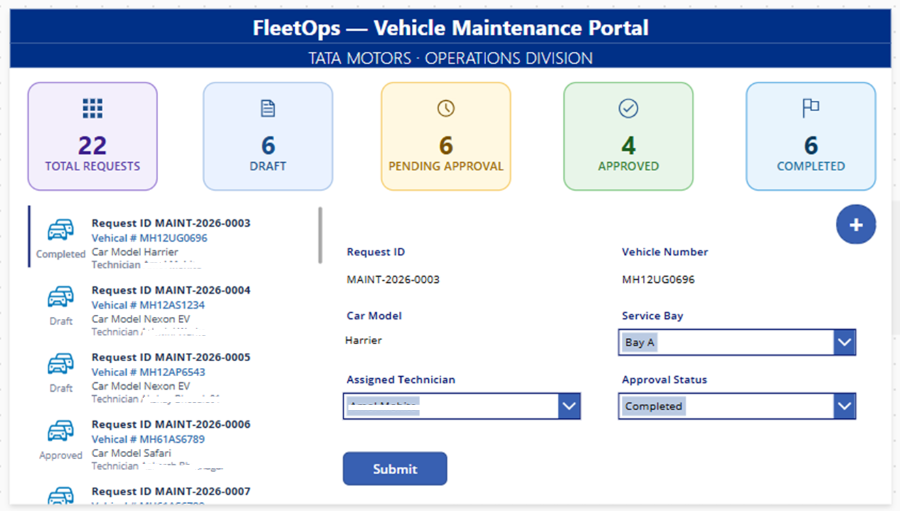

**2. Scr_Maintenance_Request:** request form, draft save, per-technician summary (`Distinct()` + `CountIf()`)
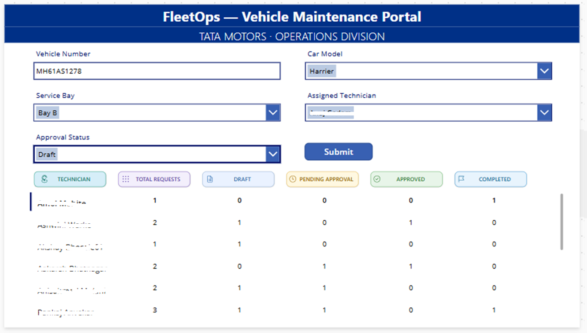

**3. Scr_Maintenance_Items:** line items (parts, consumables, labor), running total, and the flow trigger point
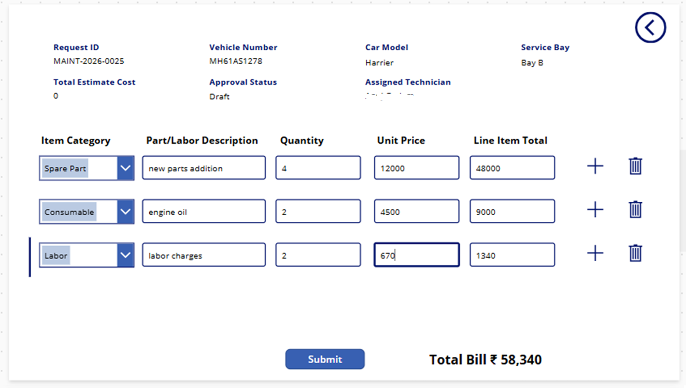

## ⚙️ Power Automate cloud flow: Total Estimated Cost Validator
Trigger on new item → get all items for the Request ID → sum line totals → update the request → generate HTML invoice → convert to PDF in OneDrive → route approval by cost.

- 🔴 **Total above ₹50,000:** approval sent to the Operations Manager by Outlook email and MS Teams with the PDF invoice attached
- 🟢 **Total ₹50,000 or less:** automatically approved

| Trigger | Cost calculation | HTML invoice |
|---|---|---|
| 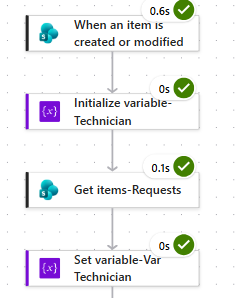 | 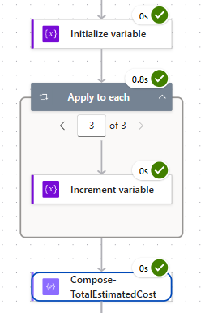 | 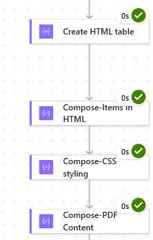 |

| Update SharePoint | PDF convert |
|---|---|
| 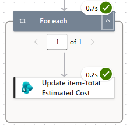 | 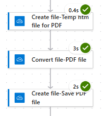 |

**Approval routing**
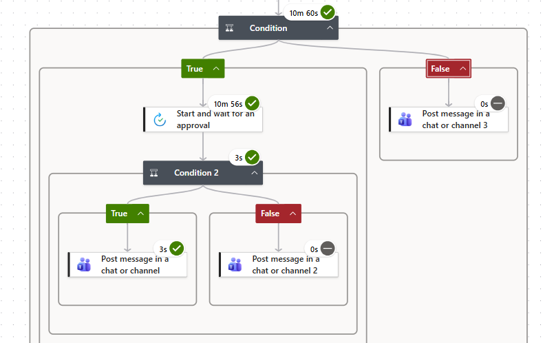

## ✉️ Proof of automation
**Approval notification received in Outlook** (one-click Approve/Reject, PDF attached)
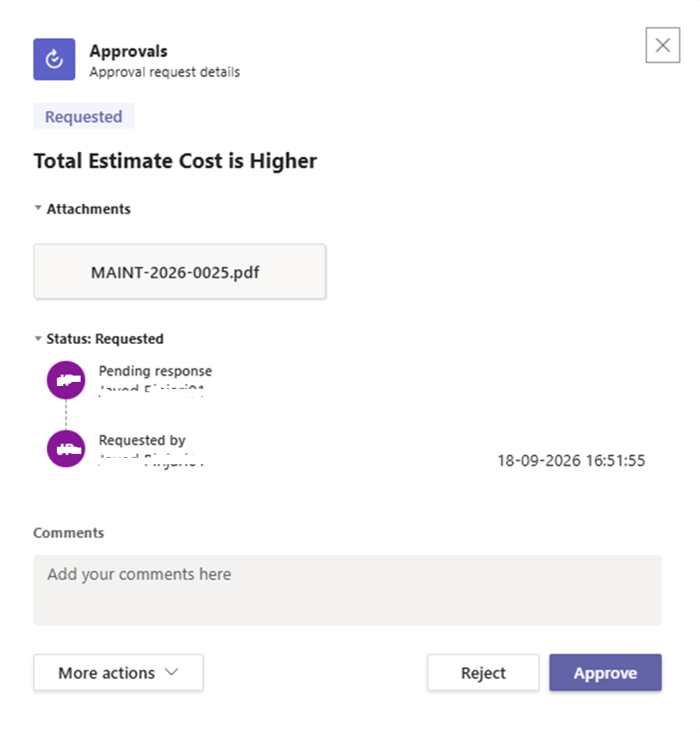

**PDF invoice generated by the flow and stored in OneDrive**
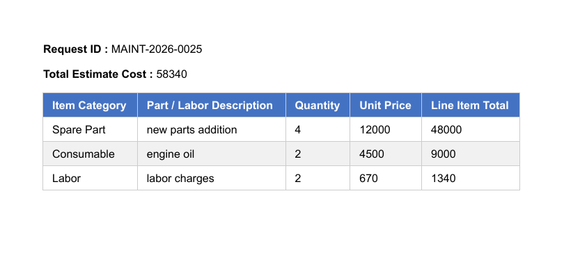

## 🗂️ SharePoint lists
**Maintenance Requests-JP:** Request ID, vehicle number and model, service bay, assigned technician, total estimated cost (set by the flow), approval status
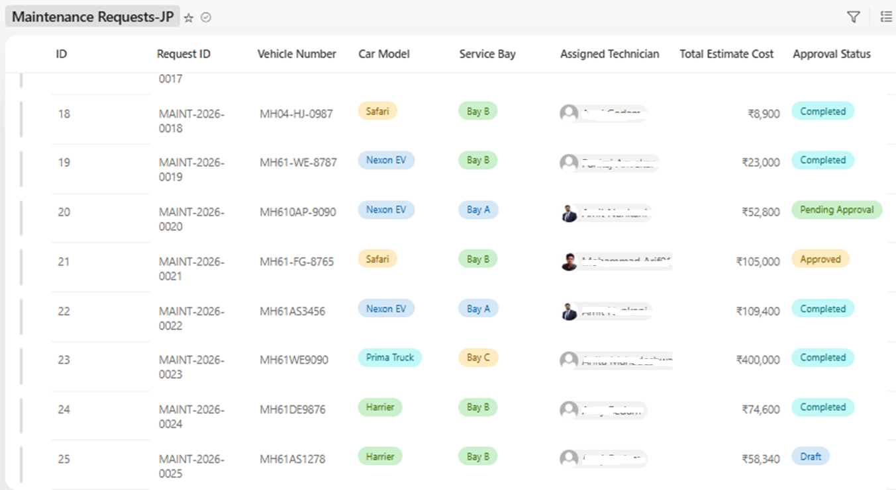

**Maintenance Items-JP:** request lookup, item category, description, quantity and unit price, line total; every insert triggers the flow
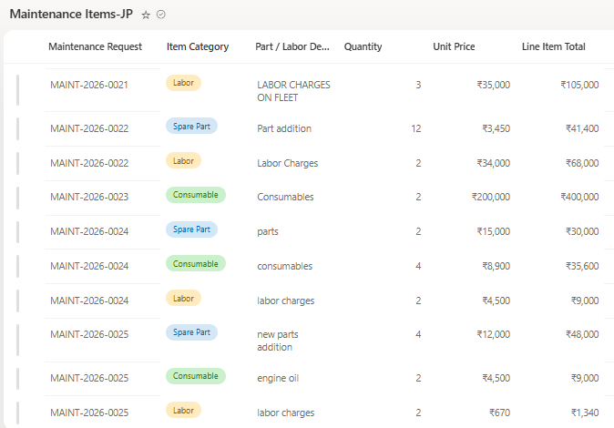

## 🚀 ALM: DEV → PROD
- App, cloud flow, connection references and environment variables packaged in one solution (unmanaged in DEV, managed in PROD)
- SharePoint site URL and list names are **environment variables**, not hardcoded
- Connections travel as **connection references** and are re-pointed during import
- Separate DEV and PROD environments

| Solution in DEV | Settings step | Environments |
|---|---|---|
| 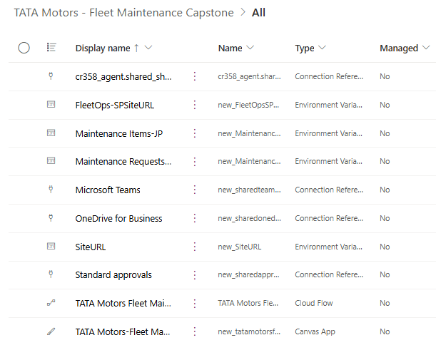 | 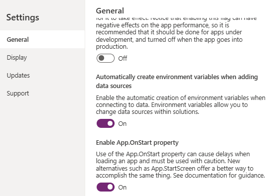 | 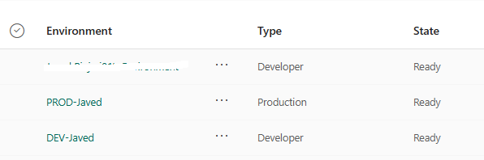 |

| Requests list variable | Items list variable | Site URL variable |
|---|---|---|
| 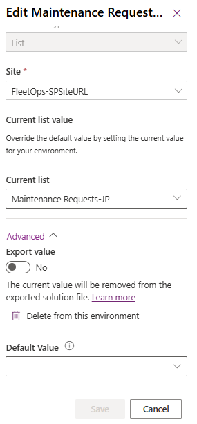 | 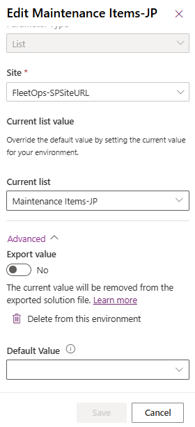 | 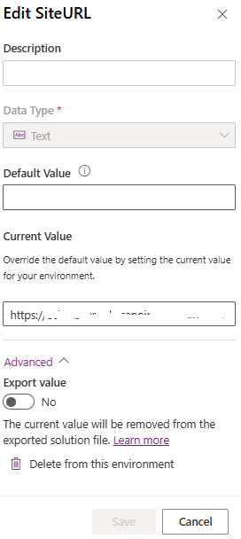 |

**Flow trigger in PROD reading site and lists through environment variables**
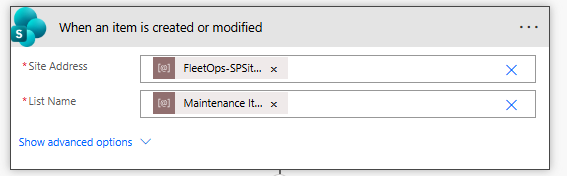

## 🛠️ Tech stack
Power Apps Canvas · Power Automate · SharePoint Online · OneDrive · Outlook · MS Teams · Solutions · Environment Variables · Connection References

## 📈 Delivered
100% automated invoice generation · 4 approval stages · ₹50K auto-approval threshold · 3 canvas screens · 2 SharePoint lists · 0 manual steps for cost calculation

## 👤 Author
**Javed Pinjari**: Power Platform Developer · [LinkedIn](https://www.linkedin.com/in/javed-pinjari-0a176582/) · [GitHub](https://github.com/javedmcs83-ali)
